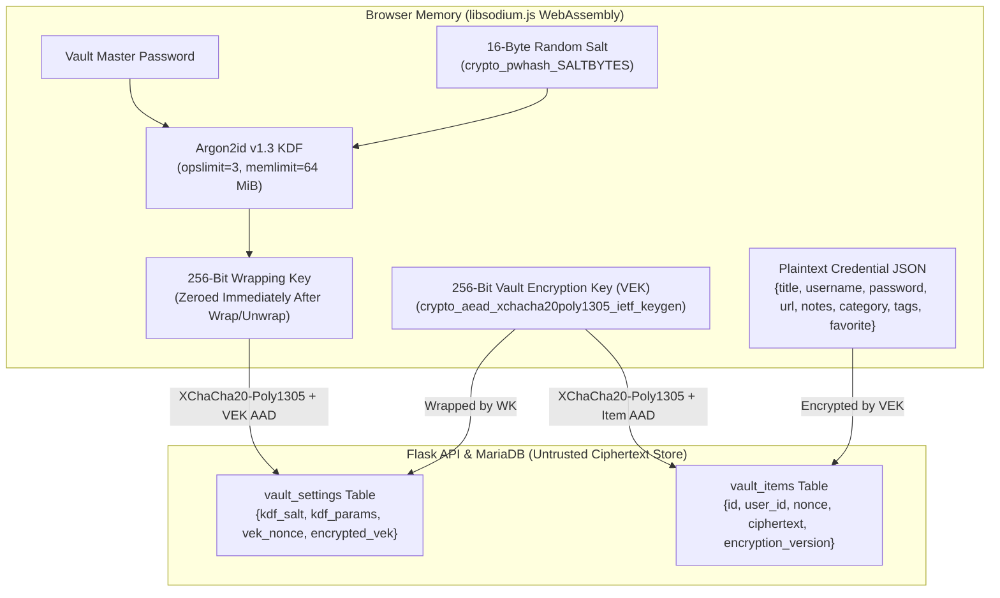

# AegisVault — Self-Hosted Zero-Knowledge Password Manager

AegisVault is a production-grade, self-hosted password manager engineered with **Python 3 (Flask)**, **MariaDB**, **Redis**, **Nginx**, **Docker Compose**, and a **Vanilla JavaScript + Vite + `libsodium.js` (WebAssembly)** frontend.

It implements **client-side envelope encryption** (`Argon2id` + `XChaCha20-Poly1305-IETF`) with a strict architectural boundary between server authentication (**Account Login Password**) and browser-only vault decryption (**Vault Master Password**). The backend server and database never receive, process, or store plaintext credentials, master passwords, or unwrapped encryption keys.

---

## Table of Contents

1. [Project Overview & Learning Objectives](#1-project-overview--learning-objectives)
2. [Technology Stack](#2-technology-stack)
3. [Cryptographic & Security Architecture](#3-cryptographic--security-architecture)
4. [Complete Directory Structure](#4-complete-directory-structure)
5. [Database Design](#5-database-design)
6. [Installation & Running the Project](#6-installation--running-the-project)
   - [Option A: Run with Docker Compose (Recommended)](#option-a-run-with-docker-compose-recommended)
   - [Option B: Local Development Setup (Python + Node.js)](#option-b-local-development-setup-python--nodejs)
7. [Step-by-Step Application Usage Guide](#7-step-by-step-application-usage-guide)
8. [REST API Reference Summary](#8-rest-api-reference-summary)
9. [Running Automated Tests](#9-running-automated-tests)
10. [Production Ubuntu VPS Deployment](#10-production-ubuntu-vps-deployment)
11. [Threat Model & Known Security Limitations](#11-threat-model--known-security-limitations)
12. [Detailed Documentation Index](#12-detailed-documentation-index)

---

## 1. Project Overview & Learning Objectives

AegisVault allows users to register an account, authenticate over server-side Redis sessions, initialize a client-side encrypted vault, unlock their vault in browser memory, create/edit/delete credentials, search and filter entries locally, generate high-entropy passwords using a CSPRNG, rotate their master password without re-encrypting every vault item, and export/restore encrypted backups.

### Core Engineering & Security Objectives

- **Modular Flask Backend Development:** Uses the Flask application factory pattern (`create_app`), Blueprints (`/api/auth`, `/api/vault`), and service/schema separation.
- **REST API Validation & Defense-in-Depth:** Validates every incoming payload with `Marshmallow` schemas, enforces request size limits (`MAX_CONTENT_LENGTH`), and rejects unexpected fields or client-only secrets.
- **Relational Database Modeling & Migrations:** Uses `Flask-SQLAlchemy` and `Flask-Migrate` (`Alembic`) with `PyMySQL` for MariaDB connectivity, foreign key cascades, and indexed lookups.
- **Server-Side Sessions & Rate Limiting:** Uses `Flask-Session` and `Flask-Limiter` backed by Redis, with fail-closed `503 Service Unavailable` behavior if Redis becomes unreachable.
- **Client-Side Cryptography & Key Management:** Implements Argon2id key derivation and XChaCha20-Poly1305 authenticated encryption in the browser using `libsodium-wrappers-sumo` (WebAssembly).
- **Web Security Hardening:** Enforces `Flask-WTF` CSRF protection via `X-CSRF-Token` headers, `HttpOnly`/`SameSite`/`Secure` cookies, anti-IDOR ownership checks, and a strict `Content-Security-Policy` compatible with WebAssembly (`'wasm-unsafe-eval'`).
- **Container Orchestration:** Orchestrates `nginx`, `api`, `mariadb`, and `redis` across isolated Docker bridge networks (`frontend_net` and `backend_net`) with non-root container execution.

---

## 2. Technology Stack

| Layer | Technology | Role in AegisVault |
| :--- | :--- | :--- |
| **Backend Framework** | Python 3, Flask 3.1, Gunicorn 23.0 | Modular REST API server and production WSGI worker pool |
| **ORM & Migrations** | Flask-SQLAlchemy 3.1, SQLAlchemy 2.0, Flask-Migrate 4.1, PyMySQL 1.1 | Parameterized database queries, schema migrations, and MariaDB driver |
| **Server Auth & Security** | `argon2-cffi` 23.1, Flask-Session 0.8, Flask-WTF 1.2, Flask-Limiter 3.10 | Server-side Argon2id login password hashing, Redis sessions, CSRF protection, and brute-force rate limiting |
| **Request Validation** | Marshmallow 3.26 | Strict JSON schema validation, base64 byte-length verification, and KDF parameter bounds |
| **Frontend Runtime** | HTML5, CSS3, Vanilla JavaScript (ES Modules), Vite | Responsive zero-framework UI with explicit DOM XSS escaping |
| **Client Cryptography** | `libsodium-wrappers-sumo` (WASM) & Web Crypto API | Browser-side Argon2id KDF, XChaCha20-Poly1305 AEAD, memory zeroing, and CSPRNG password generation |
| **Infrastructure** | MariaDB 11.4, Redis 7.4, Nginx 1.27 (Unprivileged), Docker Compose | Persistent encrypted data store, session/rate-limit store, reverse proxy, and container orchestration |
| **Automated Testing** | `pytest` 8.3 + `fakeredis` (Backend), `Vitest` + `JSDOM` (Frontend) | Unit, integration, security, and cryptographic test suites |

---

## 3. Cryptographic & Security Architecture

### 3.1 Strict Separation of Secrets

AegisVault enforces two completely independent passwords with distinct trust boundaries:

1. **Account Login Password (Server Authentication Secret):**
   - Sent to `/api/auth/register` and `/api/auth/login` over HTTPS.
   - Hashed on the server using `argon2-cffi` (`Argon2id`, `time_cost=3`, `memory_cost=65536 KiB`, `parallelism=2`).
   - Grants access only to the user's authenticated API session and encrypted ciphertexts; **it cannot decrypt the vault**.
2. **Vault Master Password (Browser-Only Encryption Secret):**
   - Entered only in the browser during vault initialization, vault unlock, master-password rotation, or backup restoration.
   - **Never transmitted to Flask, never stored in MariaDB/Redis, and never logged.** The backend Marshmallow schemas actively reject any request payload that includes a `master_password` field.

### 3.2 Envelope Encryption & Authenticated Additional Data (AAD)



1. **VEK Generation:** During vault setup, the browser generates a cryptographically random 256-bit (32-byte) **Vault Encryption Key (VEK)** using `sodium.crypto_aead_xchacha20poly1305_ietf_keygen()`.
2. **Wrapping Key Derivation:** The browser generates a 16-byte random salt and derives a 256-bit **Wrapping Key** from the user's Vault Master Password using `sodium.crypto_pwhash` (`ALG_ARGON2ID13`, `opslimit=3`, `memlimit=64 MiB`).
3. **VEK Wrapping:** The browser encrypts the 256-bit VEK with `XChaCha20-Poly1305` using a 24-byte random nonce and canonical Authenticated Additional Data (AAD):
   ```json
   {"purpose":"aegisvault-vek-wrap","u":"<user_uuid>","v":1,"kv":1}
   ```
   The temporary Wrapping Key is immediately zeroed in memory.
4. **Per-Item Encryption & AAD Binding:** Every credential entry (`title`, `username`, `password`, `url`, `notes`, `category`, `tags`, `favorite`) is serialized into a single JSON object and encrypted in the browser using the unlocked VEK, a fresh 24-byte random nonce, and item-specific AAD:
   ```json
   {"purpose":"aegisvault-item","u":"<user_uuid>","i":"<item_uuid>","v":1}
   ```
   During decryption, the browser reconstructs this AAD and verifies the Poly1305 authentication tag. If an attacker with database access swaps ciphertexts between two items or between two users, decryption fails deterministically.

---

## 4. Complete Directory Structure

```text
password-manager/
├── README.md                          # Project overview, architecture, and usage guide
├── .env.example                       # Template environment variables (no real secrets)
├── .gitignore                         # Prevents .env, keys, DB files, and build artifacts from git
├── Dockerfile                         # Non-root Python 3.11 + Gunicorn container image
├── docker-entrypoint.sh               # Runs Flask-Migrate upgrades before starting Gunicorn
├── docker-compose.yml                 # Orchestrates mariadb, redis, api, and nginx services
├── Makefile                           # Shortcut commands for build, run, migrate, and test
├── requirements.txt                   # Pinned Python backend & test dependencies
├── wsgi.py                            # WSGI application entry point
├── app/
│   ├── __init__.py                    # Flask application factory, health/CSRF routes, error handlers
│   ├── config.py                      # Dev/Test/Prod configurations and production secret validation
│   ├── extensions.py                  # SQLAlchemy, Migrate, CSRFProtect, Session, and Limiter instances
│   ├── models/
│   │   ├── __init__.py                # Model exports and SQLite foreign-key pragma hook
│   │   ├── user.py                    # User model (UUID, email, Argon2id login_password_hash)
│   │   └── vault.py                   # VaultSettings and VaultItem models (ciphertext-only storage)
│   ├── blueprints/
│   │   ├── __init__.py                # Blueprint exports
│   │   ├── auth.py                    # /api/auth/* routes (register, login, logout, me)
│   │   └── vault.py                   # /api/vault/* routes (settings, setup, master-password, items, export, import)
│   ├── services/
│   │   ├── __init__.py
│   │   ├── auth_service.py            # Registration, constant-time login verification, session rotation
│   │   └── vault_service.py           # Encrypted VEK management, ownership-checked CRUD, atomic backup import
│   ├── security/
│   │   ├── __init__.py
│   │   ├── password_hashing.py        # Argon2id hashing and dummy-hash verification against enumeration
│   │   ├── authorization.py           # @login_required decorator and resource ownership checks
│   │   └── headers.py                 # CSP, security headers, and SensitiveDataLogFilter
│   ├── schemas/
│   │   ├── __init__.py
│   │   ├── auth.py                    # Marshmallow schemas for registration and login
│   │   └── vault.py                   # Marshmallow schemas for KDF bounds, ciphertexts, and backups
│   └── migrations/                    # Alembic / Flask-Migrate database migration scripts
├── frontend/
│   ├── package.json                   # Vanilla JS + Vite + libsodium-wrappers-sumo dependencies
│   ├── package-lock.json              # Locked frontend dependency tree
│   ├── vite.config.js                 # Vite bundler and Vitest configuration
│   ├── index.html                     # Main HTML shell
│   ├── src/
│   │   ├── main.js                    # Application bootstrapper
│   │   ├── styles.css                 # Responsive dark-slate security UI stylesheet
│   │   ├── api/client.js              # Same-origin fetch wrapper with in-memory CSRF token handling
│   │   ├── auth/auth.js               # Client authentication helpers
│   │   ├── crypto/sodium.js           # libsodium WebAssembly loader, CSPRNG, base64, and buffer zeroing
│   │   ├── crypto/key-derivation.js   # Bounded Argon2id key derivation in browser
│   │   ├── crypto/vault-crypto.js     # XChaCha20-Poly1305 VEK wrapping, item AEAD, and AAD binding
│   │   ├── vault/vault-state.js       # Volatile in-memory state manager for VEK and decrypted items
│   │   ├── vault/vault-ui.js          # XSS-safe DOM controller for all screens and modals
│   │   ├── generator/password-generator.js # Unbiased CSPRNG password generator and entropy estimator
│   │   ├── security/auto-lock.js      # Configurable inactivity auto-lock timer
│   │   ├── security/clipboard.js      # Clipboard copy helper with 25-second auto-clear
│   │   └── utils/validation.js        # Client-side form and backup format validators
│   └── tests/
│       ├── crypto.test.js             # Vitest suite for client-side cryptography and generator
│       └── ui.test.js                 # Vitest suite for DOM XSS escaping, UI states, and auto-lock
├── nginx/
│   ├── Dockerfile                     # Multi-stage build (Node 22 Vite build -> unprivileged Nginx)
│   └── nginx.conf                     # Static serving, /api/ reverse proxy, timeouts, and CSP headers
├── tests/
│   ├── conftest.py                    # Pytest fixtures and synthetic ciphertext generators
│   ├── unit/
│   │   └── test_models_and_hashing.py # Unit tests for Argon2id, cascade deletes, and migrations
│   ├── integration/
│   │   └── test_auth_and_vault.py     # End-to-end API tests for auth, CRUD, key rotation, and backups
│   └── security/
│       └── test_security_controls.py  # CSRF, IDOR isolation, rate limiting, Redis outage, and log filter tests
└── docs/
    ├── ARCHITECTURE.md                # Detailed architecture and Mermaid diagrams
    ├── THREAT_MODEL.md                # Threat model, DB compromise analysis, and limitations
    ├── API.md                         # Full REST API specification
    ├── DEPLOYMENT.md                  # Docker Compose & Ubuntu VPS HTTPS deployment guide
    └── SECURITY_CHECKLIST.md          # Security verification matrix
```

---

## 5. Database Design

AegisVault uses three relational tables managed via SQLAlchemy and Alembic migrations (`app/migrations/versions/0001_initial_schema.py`):

1. **`users`**:
   - `id` (`VARCHAR(36)`, Primary Key, UUIDv4)
   - `email` (`VARCHAR(255)`, Unique, Indexed, Normalized lowercase)
   - `login_password_hash` (`VARCHAR(255)`, Argon2id hash)
   - `is_active` (`BOOLEAN`), `disabled_at` (`DATETIME`), `created_at` (`DATETIME`), `updated_at` (`DATETIME`)
2. **`vault_settings`**:
   - `user_id` (`VARCHAR(36)`, Primary Key & Foreign Key -> `users.id ON DELETE CASCADE`)
   - `kdf_algorithm` (`VARCHAR(32)`, `'argon2id13'`), `kdf_version` (`INT`, `1`)
   - `kdf_salt` (`VARCHAR(128)`, Base64 16-byte salt)
   - `kdf_opslimit` (`INT`), `kdf_memlimit` (`INT`)
   - `encrypted_vek` (`TEXT`, Base64 48-byte XChaCha20-Poly1305 wrapped VEK)
   - `vek_nonce` (`VARCHAR(128)`, Base64 24-byte nonce)
   - `encryption_version` (`INT`, `1`), `inactivity_timeout_minutes` (`INT`, default `5`), `updated_at` (`DATETIME`)
3. **`vault_items`**:
   - `id` (`VARCHAR(36)`, Primary Key, UUIDv4)
   - `user_id` (`VARCHAR(36)`, Foreign Key -> `users.id ON DELETE CASCADE`, Indexed)
   - `ciphertext` (`TEXT`, Base64 XChaCha20-Poly1305 encrypted JSON payload)
   - `nonce` (`VARCHAR(128)`, Base64 24-byte nonce)
   - `encryption_version` (`INT`, `1`), `created_at` (`DATETIME`), `updated_at` (`DATETIME`)

> **Zero Plaintext Guarantee:** The `vault_items` table contains **no columns** for titles, usernames, URLs, notes, categories, tags, or passwords. All sensitive attributes are encrypted together inside `ciphertext` before leaving the browser.

---

## 6. Installation & Running the Project

### Option A: Run with Docker Compose (Recommended)

Docker Compose starts the full stack (`mariadb`, `redis`, `api`, and `nginx`) on isolated internal networks and exposes only the Nginx reverse proxy on `http://localhost:8080`.

#### Step 1: Create `.env` from `.env.example`

```bash
cp .env.example .env
```

Generate cryptographically strong secrets and update `.env`:

```bash
python3 -c 'import secrets; print("SECRET_KEY=" + secrets.token_hex(32))'
python3 -c 'import secrets; print("MYSQL_ROOT_PASSWORD=" + secrets.token_urlsafe(32))'
python3 -c 'import secrets; print("MYSQL_PASSWORD=" + secrets.token_urlsafe(32))'
python3 -c 'import secrets; print("REDIS_PASSWORD=" + secrets.token_urlsafe(32))'
```

*(Ensure `DATABASE_URL`, `REDIS_URL`, and `RATELIMIT_STORAGE_URI` in `.env` use the matching passwords you generated.)*

#### Step 2: Build and Start Containers

```bash
docker compose up --build -d
```

#### Step 3: Verify Service Health

```bash
docker compose ps
curl -i http://127.0.0.1:8080/api/health
```

Expected response:

```json
{
  "database": "connected",
  "redis": "connected",
  "status": "healthy"
}
```

Open **`http://localhost:8080`** in your browser.

#### Step 4: Stop Containers

```bash
# Stop containers while preserving MariaDB data volume
docker compose down

# Or stop and wipe volumes for a clean reset
docker compose down -v
```

---

### Option B: Local Development Setup (Python + Node.js)

If you want to run the backend and frontend directly on your workstation for development or debugging:

#### 1. Install Python Dependencies & Run Migrations

```bash
python3 -m venv .venv
source .venv/bin/activate
pip install -r requirements.txt

# Apply database migrations (defaults to instance/aegisvault_dev.db in development mode)
flask --app wsgi:app db upgrade --directory app/migrations
```

#### 2. Install Frontend Dependencies & Start Dev Server

```bash
npm install
npm run dev
```

This starts the Flask backend on `http://127.0.0.1:5000` and the Vite frontend / reverse proxy server on `http://localhost:3000`.

---

## 7. Step-by-Step Application Usage Guide

### Step 1: Register an Account (`/api/auth/register`)
1. Open the web interface and select the **Create New Account** tab.
2. Enter your email address and an **Account Login Password** (minimum 10 characters).
3. Click **Create Account & Continue**. The server hashes your Account Login Password with Argon2id and establishes an `HttpOnly` Redis-backed session.

### Step 2: Initialize Your Encrypted Vault (`/api/vault/setup`)
1. Immediately after registration, you are presented with the **Initialize Encrypted Vault** screen.
2. Enter a strong **Vault Master Password** (minimum 10 characters, distinct from your Account Login Password) and select an **Inactivity Auto-Lock Timeout** (default: `5 minutes`).
3. Click **Generate VEK & Initialize Vault**.
   - Your browser generates a 256-bit random VEK in memory, derives an Argon2id wrapping key from your Vault Master Password, wraps the VEK with XChaCha20-Poly1305, and uploads only the wrapped VEK envelope to the server.
   - **Important:** Record your Vault Master Password safely. Because the server never sees your Vault Master Password or raw VEK, a forgotten master password cannot be recovered.

### Step 3: Create, View, Search, and Manage Credentials
1. In the unlocked **Credentials** dashboard, click **+ New Credential**.
2. Fill in the **Service or Title**, **Category**, **Username or Email**, **Website URL**, **Password or Secret** (or click **Generate Strong Password** inside the modal), **Tags**, and **Encrypted Notes**.
3. Click **Encrypt & Save**. The browser encrypts all fields together with your unlocked VEK and binds the record's UUID and your user ID into the Poly1305 AAD before sending the ciphertext to `POST /api/vault/items`.
4. From the dashboard table, you can:
   - **Search & Filter:** Type in the search bar or click a category/Favorites filter in the sidebar. All searching and sorting operate on decrypted records in browser memory.
   - **Reveal / Hide Passwords:** Click **Reveal** on any row to toggle between masked (`••••••••••••`) and plaintext view.
   - **Copy to Clipboard:** Click **Copy** next to a username or password. Copied secrets are automatically cleared from the clipboard after **25 seconds**.
   - **Favorite / Edit / Delete:** Toggle the star icon (`★`), click **Edit** to update and re-encrypt an entry with a fresh 24-byte nonce, or click **Delete** (which prompts for confirmation before permanently deleting the record).

### Step 4: Generate High-Entropy Passwords
1. Click **Password Generator** in the top navigation bar.
2. Adjust the password length (`8`–`64` characters) and toggle character classes (**Uppercase**, **Lowercase**, **Numbers**, **Symbols**, and **Exclude Ambiguous Characters**).
3. Review the calculated entropy in bits and strength classification, then click **Copy** or **Use Password in New Credential**.

### Step 5: Lock & Unlock the Vault
- **Manual Lock:** Click **Lock Vault (`MM:SS`)** in the top-right corner at any time.
- **Automatic Inactivity Lock:** If no mouse, keyboard, touch, or scroll activity occurs within your configured timeout (default 5 minutes), the vault automatically locks.
- **What Happens on Lock:** AegisVault zeroes the `Uint8Array` VEK buffer in memory (`zeroBuffers`), clears all decrypted credential objects from state, clears any pending secret from the clipboard, and returns to the **Unlock Vault** screen.

### Step 6: Rotate Your Vault Master Password
1. Open the **Master Key & Security** tab in the top navigation bar.
2. Enter your **Current Vault Master Password**, your **New Vault Master Password**, and confirmation, and optionally adjust your **Inactivity Auto-Lock Timeout**.
3. Click **Update Master Password & Re-wrap VEK**.
   - The browser verifies your current master password by unwrapping the VEK, derives a new wrapping key with a fresh 16-byte salt, re-encrypts the existing 256-bit VEK with a fresh 24-byte nonce, and sends the updated envelope to `PUT /api/vault/settings/master-password` without needing to re-encrypt individual vault items.

### Step 7: Export & Restore Encrypted Backups
1. Open the **Encrypted Backup** tab in the top navigation bar.
2. **Export:** Click **Download Encrypted Backup (`.json`)** to save a versioned JSON bundle (`aegisvault-encrypted-backup-YYYY-MM-DD.json`) containing your KDF parameters, wrapped VEK, and encrypted items. Plaintext CSV export is intentionally omitted so backups remain safe on disk.
3. **Restore:** Select a `.json` backup file, enter the backup's **Vault Master Password**, and click **Verify & Restore Encrypted Backup**. The browser verifies the backup format, unlocks the backup VEK, authenticates every item's Poly1305 tag and AAD in memory, and atomically restores the vault via `POST /api/vault/import`.

---

## 8. REST API Reference Summary

All endpoints use the `/api` prefix and return JSON responses. State-changing requests (`POST`, `PUT`, `DELETE`) require a valid `X-CSRF-Token` header. See [`docs/API.md`](docs/API.md) for full request/response schemas.

| Method | Endpoint | Auth | CSRF | Rate Limit | Description |
| :--- | :--- | :---: | :---: | :---: | :--- |
| `GET` | `/api/health` | No | No | Exempt | Checks MariaDB and Redis connectivity (`200` or `503`) |
| `GET` | `/api/csrf-token` | No | No | 60/min | Issues a signed CSRF token bound to the current session |
| `POST` | `/api/auth/register` | No | Yes | 10/min | Registers a new user account with Argon2id password hash |
| `POST` | `/api/auth/login` | No | Yes | 10/min | Authenticates user and rotates server-side Redis session |
| `POST` | `/api/auth/logout` | Yes | Yes | 30/min | Invalidates the current server-side session |
| `GET` | `/api/auth/me` | Yes | No | 60/min | Returns authenticated user profile and vault setup status |
| `GET` | `/api/vault/settings` | Yes | No | 60/min | Returns KDF salt, bounded params, and wrapped VEK |
| `POST` | `/api/vault/setup` | Yes | Yes | 15/min | Initializes encrypted vault settings and wrapped VEK |
| `PUT` | `/api/vault/settings/master-password` | Yes | Yes | 10/min | Updates wrapped VEK, salt, and nonce on master key rotation |
| `GET` | `/api/vault/items` | Yes | No | 60/min | Lists all encrypted vault items owned by the current user |
| `POST` | `/api/vault/items` | Yes | Yes | 60/min | Stores a new client-side encrypted vault item |
| `PUT` | `/api/vault/items/<item_id>` | Yes | Yes | 60/min | Updates ciphertext and nonce of an owned vault item |
| `DELETE` | `/api/vault/items/<item_id>` | Yes | Yes | 60/min | Deletes an owned encrypted vault item |
| `GET` | `/api/vault/export` | Yes | No | 15/min | Exports versioned encrypted backup archive |
| `POST` | `/api/vault/import` | Yes | Yes | 10/min | Validates and atomically imports an encrypted backup archive |

---

## 9. Running Automated Tests

You can run the full test suite using `make test` or invoke the backend and frontend test runners directly:

### Backend Test Suite (`pytest`)

```bash
python3 -m pytest tests/ -v
```

Covers:
- Argon2id password hashing and anti-enumeration dummy verification (`tests/unit/test_models_and_hashing.py`)
- Production configuration secret validation (`tests/unit/test_models_and_hashing.py`)
- Relational cascade integrity and absence of plaintext credential columns (`tests/unit/test_models_and_hashing.py`)
- Clean Alembic migration application on an empty database (`tests/unit/test_models_and_hashing.py`)
- Registration, login, session rotation, `/api/auth/me`, and logout invalidation (`tests/integration/test_auth_and_vault.py`)
- Vault initialization, encrypted CRUD, master-password rotation without item ciphertext changes, and backup export/import (`tests/integration/test_auth_and_vault.py`)
- CSRF token enforcement and rejection of missing/forged tokens (`tests/security/test_security_controls.py`)
- Cross-user isolation and IDOR prevention across read, update, delete, and backup import (`tests/security/test_security_controls.py`)
- Brute-force login rate limiting (`429 Too Many Requests`) (`tests/security/test_security_controls.py`)
- Rejection of forbidden client secrets (`master_password`), excessive KDF parameters, and oversized payloads (`413`) (`tests/security/test_security_controls.py`)
- Fail-closed `503 REDIS_UNAVAILABLE` behavior when Redis is unreachable (`tests/security/test_security_controls.py`)
- Log sanitization of passwords, ciphertexts, cookies, and CSRF tokens (`tests/security/test_security_controls.py`)

### Frontend Cryptography & UI Test Suite (`Vitest`)

```bash
npx vitest run
```

Covers:
- End-to-end 256-bit VEK creation, Argon2id wrapping/unlocking, and XChaCha20-Poly1305 item encryption/decryption (`frontend/tests/crypto.test.js`)
- Rejection of wrong master passwords (`frontend/tests/crypto.test.js`)
- Detection of bit-flipped ciphertexts and Poly1305 authentication tags (`frontend/tests/crypto.test.js`)
- Distinct CSPRNG nonces across separate encryption operations (`frontend/tests/crypto.test.js`)
- AAD verification failure when `userId` or `itemId` context is tampered with (`frontend/tests/crypto.test.js`)
- KDF algorithm, version, and DoS memory/iteration bounds enforcement (`frontend/tests/crypto.test.js`)
- Master-password change re-wrapping the VEK without modifying item ciphertexts (`frontend/tests/crypto.test.js`)
- Encrypted backup validation, restoration, and VEK buffer zeroing on lock (`frontend/tests/crypto.test.js`)
- CSPRNG password generator character-class compliance and ambiguous character exclusion (`frontend/tests/crypto.test.js`)
- DOM XSS HTML escaping, auth/setup UI rendering, in-memory search filtering, and inactivity auto-lock expiration (`frontend/tests/ui.test.js`)

---

## 10. Production Ubuntu VPS Deployment

When deploying to an Ubuntu VPS over an untrusted network:

1. **Always enforce HTTPS (TLS 1.2/1.3):** Local HTTP (`http://localhost:8080`) is strictly for local loopback development. Never transmit account passwords over unencrypted HTTP on a public network.
2. **Set `SESSION_COOKIE_SECURE=true` and `FLASK_ENV=production` in `.env`:** Gunicorn runs `validate_production_config()` at startup and refuses to boot if `SECRET_KEY`, `DATABASE_URL`, or `REDIS_URL` are missing or contain placeholder values.
3. **Follow the step-by-step instructions in [`docs/DEPLOYMENT.md`](docs/DEPLOYMENT.md)** for UFW firewall hardening, Let's Encrypt certificate provisioning via Certbot, and the production HTTPS Nginx configuration.

---

## 11. Threat Model & Known Security Limitations

### What a Database or Redis Compromise Can and Cannot Expose

- **Cannot Expose:** Vault Master Passwords, raw 256-bit VEKs, or any credential field (titles, usernames, passwords, URLs, notes, categories, or tags). Even if MariaDB and Redis are dumped completely, all vault items remain encrypted with XChaCha20-Poly1305 under a 256-bit VEK wrapped by an Argon2id key (`64 MiB` memory cost).
- **Can Expose:** User email addresses, salted Argon2id hashes of Account Login Passwords, KDF parameters/salts, encrypted ciphertexts, item counts, and record creation/update timestamps.

### Known Architectural Limitations

1. **Unrecoverable Vault Master Password:** Because AegisVault is zero-knowledge and never transmits the Vault Master Password or raw VEK to the backend, a forgotten Vault Master Password cannot be reset via email or via the Account Login Password. Users should keep a secure offline record of their Master Password and download encrypted backups regularly.
2. **JavaScript Process Memory Erasure:** Locking the vault overwrites the `Uint8Array` VEK buffer with zeros (`zeroBuffers`) and drops references to decrypted objects. However, JavaScript engines manage string primitives as immutable garbage-collected values and cannot guarantee immediate physical RAM erasure prior to garbage collection.
3. **Endpoint & Static Asset Integrity:** Client-side encryption protects vault confidentiality against network, database, and cache breaches, but cannot protect a user who unlocks their vault on a device infected with keylogging malware/malicious browser extensions or against a compromised server actively serving modified JavaScript.

---

## 12. Detailed Documentation Index

- **[`docs/ARCHITECTURE.md`](docs/ARCHITECTURE.md)** — System architecture, network topology, envelope encryption design, and Mermaid diagrams.
- **[`docs/THREAT_MODEL.md`](docs/THREAT_MODEL.md)** — Trust boundaries, database/Redis compromise analysis, attack mitigations, and residual risks.
- **[`docs/API.md`](docs/API.md)** — Complete REST API specification with request/response payloads and status codes.
- **[`docs/DEPLOYMENT.md`](docs/DEPLOYMENT.md)** — Local Docker Compose instructions, Ubuntu VPS hardening, and Let's Encrypt HTTPS configuration.
- **[`docs/SECURITY_CHECKLIST.md`](docs/SECURITY_CHECKLIST.md)** — Security verification checklist and known limitations.
