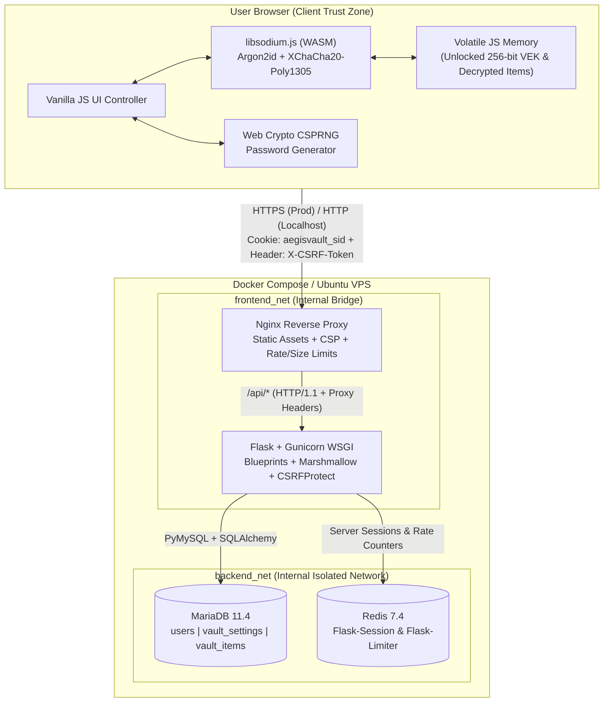
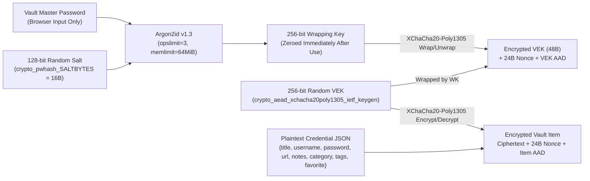

# AegisVault System & Cryptographic Architecture

## 1. High-Level System Architecture

AegisVault is a self-hosted, zero-knowledge password manager designed around two strict architectural boundaries:

1. **Network & Infrastructure Boundary:** Public traffic terminates at an unprivileged Nginx container. The Python Flask/Gunicorn API, MariaDB relational database, and Redis store reside on isolated internal Docker networks (`frontend_net` and `backend_net`) and are never exposed directly to the host network interface.
2. **Cryptographic Trust Boundary:** All vault key generation, Argon2id key derivation for vault unlocking, XChaCha20-Poly1305 encryption/decryption, password generation, and search/filtering occur exclusively in the user's browser via `libsodium.js` (WebAssembly). The Flask backend and MariaDB database store only authenticated ciphertext envelopes.



---

## 2. Separation of Authentication and Encryption Secrets

AegisVault requires two distinct user secrets with non-overlapping roles:

| Secret | Where It Is Processed | Cryptographic Purpose | Server Visibility |
| :--- | :--- | :--- | :--- |
| **Account Login Password** | Sent over TLS to `/api/auth/register` or `/api/auth/login` | Authenticates the user to the Flask backend using server-side `argon2-cffi` (`Argon2id`, `t=3`, `m=64 MiB`, `p=2`) | Server receives during auth and stores only the salted Argon2id hash (`users.login_password_hash`) |
| **Vault Master Password** | Processed exclusively in the browser via `libsodium-wrappers-sumo` | Derives a 256-bit `Wrapping Key` via Argon2id to encrypt/decrypt the random 256-bit `Vault Encryption Key (VEK)` | **Never transmitted, logged, or stored on the server** (`RegisterSchema` and `BaseStrictSchema` actively reject any payload containing `master_password`) |

---

## 3. Envelope Encryption & Key Hierarchy



### 3.1 Authenticated Additional Data (AAD) Binding

To prevent an attacker with database write access from moving ciphertexts between users or swapping records within a user's vault, every XChaCha20-Poly1305 encryption operation binds canonical JSON Authenticated Additional Data (AAD):

- **VEK Envelope AAD:**
  ```json
  {"purpose":"aegisvault-vek-wrap","u":"<user_uuid>","v":1,"kv":1}
  ```
- **Vault Item AAD:**
  ```json
  {"purpose":"aegisvault-item","u":"<user_uuid>","i":"<item_uuid>","v":1}
  ```

During decryption, the browser reconstructs the AAD from the authenticated user ID, the item's UUID, and `encryption_version`. Any modification to `user_id`, `item_id`, `encryption_version`, `nonce`, or `ciphertext` causes Poly1305 tag verification to fail deterministically.

### 3.2 Master-Password Rotation Without Re-Encrypting Items

When a user rotates their Vault Master Password:
1. The browser verifies the current Master Password by unwrapping the 256-bit `VEK`.
2. The browser generates a new 16-byte `kdf_salt` and a new 24-byte `vek_nonce`.
3. A new 256-bit wrapping key is derived via Argon2id from the new Master Password and new salt.
4. The existing 256-bit `VEK` is encrypted under the new wrapping key and sent to `PUT /api/vault/settings/master-password`.
5. Temporary buffers (`wrappingKey`, old `unwrappedVek`) are zeroed via `zeroBuffers`.
6. Because the underlying `VEK` has not changed, existing `vault_items` ciphertexts remain valid without expensive bulk re-encryption.
